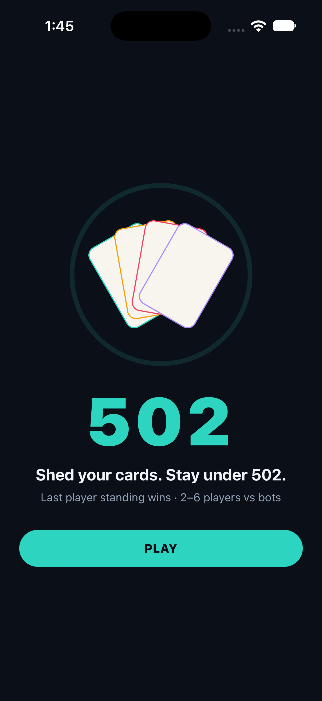
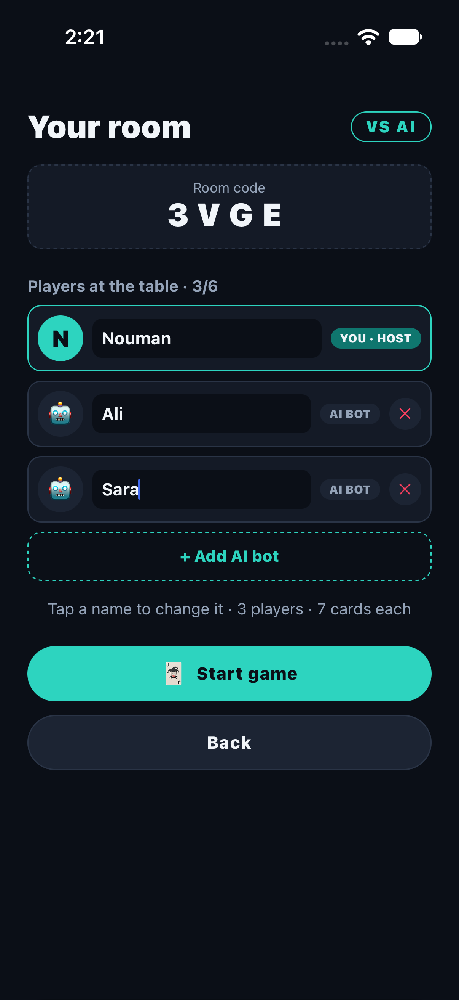
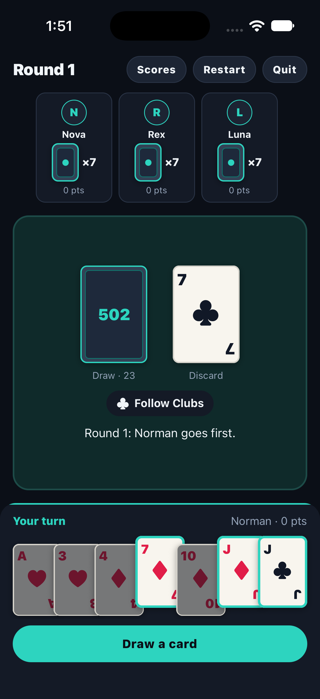
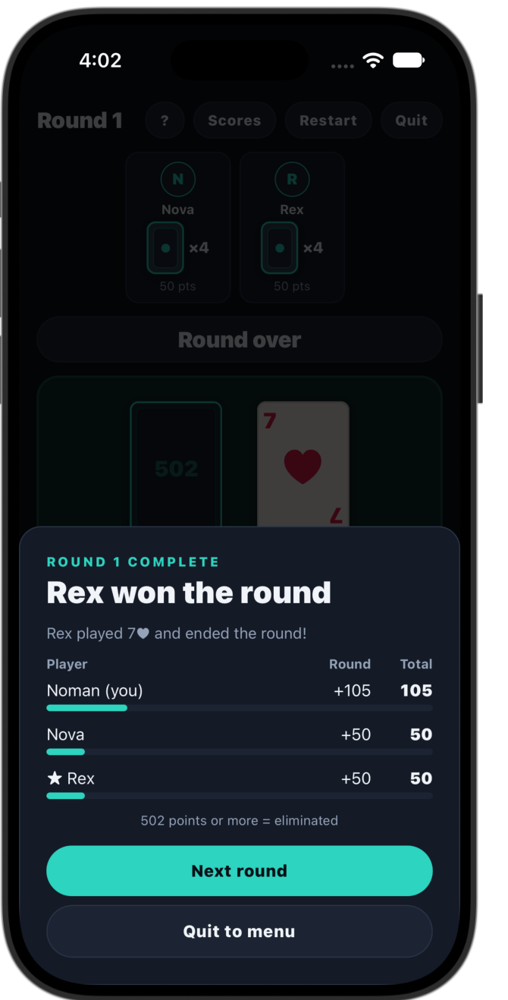

# 502 – Card Game (React Native)

A mobile version of the **502** shedding card game from
[502-game.vercel.app](https://502-game.vercel.app/), built with **React Native CLI**
and **TypeScript**. You play against 1–5 computer opponents. The rules follow the
original game. The interface, colours and animations are our own design.

> Animations use **[lottie-react-native](https://github.com/lottie-react-native/lottie-react-native)**
> (Lottie / LottieFiles format), plus React Native's built-in `Animated` API.

---

## How to play

**Goal:** get rid of your cards. Cards left in your hand when a round ends count
as penalty points. Reach **502 or more** and you are eliminated. The **last
player still in the game wins.**

1. Everyone gets **7 cards**. One card is turned up to start the discard pile.
2. On your turn, do **one** of these:
   - **play a card** that matches the top card's **suit** or **value**, or
   - **draw one card**. A drawn card cannot be played on the same turn.
3. **Special cards**

| Card | Effect |
|---|---|
| **Jack** (any) | Wild. Name a suit, and the next player must follow it (or play a Jack or the 7♥). |
| **7♥** | Wild. Ends the round immediately. Whoever plays it wins the round. |
| **2** | The next player draws 2, or stacks another 2 (the penalty becomes 4, 6, 8 …). |
| **A♠** | The next player draws 5, or passes it on with any other Ace. It stays at 5. |
| **8** | The next player is skipped, or passes the skip on with their own 8. |

   While a penalty is waiting, you may only answer with the matching card type
   (a 2, an Ace, or an 8), or accept the penalty. A Jack or the 7♥ cannot cancel it.

4. **The round ends** when someone plays their last card or plays the 7♥. If the
   last card is a 2 or the A♠, the next player still draws the penalty first.
5. **Scoring** (per card left in hand):

| Cards | Points |
|---|---|
| 7♥, A♠ | 100 |
| 2, 8, Jack | 30 |
| A♥, A♦, A♣ | 20 |
| 10, Q, K | 10 |
| 3, 4, 5, 6, 7, 9 | 5 |

6. **Elimination:** totals carry over between rounds. After each round, anyone at
   **502+** is out, except the round winner, who is safe that round. If **everyone**
   left crosses 502 in the same round, the **lowest total wins**.
7. The player with the **fewest points last round** starts the next round.

---

## Running the app

**Requirements:** Node ≥ 22, JDK 17, Android Studio (SDK and an emulator) and/or
Xcode with CocoaPods. See the
[React Native environment setup](https://reactnative.dev/docs/set-up-your-environment).

```bash
npm install                     # JavaScript dependencies

# iOS only (first time, and after adding native packages)
bundle install
cd ios && bundle exec pod install && cd ..

npm start                       # Metro bundler (keep it running)
npm run android                 # in a second terminal, or:
npm run ios
```

```bash
npm test                        # 39 tests for the rules and the AI
npm run lint
```

---

## Project structure

```
App.tsx                      Root: switches between Home → Setup → Game screens
index.js                     Registers the App component with React Native
src/
  engine/                    Game logic: pure TypeScript, no React
    types.ts                 Data shapes: Card, Player, GameState, GameAction
    deck.ts                  Create and shuffle the deck, card points, start-card check
    rules.ts                 canPlayCard(): the matching rules
    game.ts                  gameReducer(): play / draw / accept / next round / new game,
                             plus scoring and elimination
    ai.ts                    chooseAiAction(): the bots' strategy
    index.ts                 Re-exports the engine
  hooks/useGame.ts           useReducer + automatic bot turns (with a delay)
  screens/
    HomeScreen.tsx           Lottie logo, title, Play button
    SetupScreen.tsx          Your name and number of bots
    GameScreen.tsx           The game table
  components/
    PlayingCard.tsx          One card (face or back, playable / dimmed)
    OpponentSeat.tsx         A bot's seat (pulses on their turn)
    AppButton.tsx            Animated button
    SuitPicker.tsx           "Name a suit" pop-up for Jacks
    ScoreTable.tsx           Scores with progress bars to 502
    RoundSummaryModal.tsx    End-of-round results (Lottie on elimination)
    GameOverModal.tsx        Winner screen (Lottie confetti) + Play again
    ErrorBoundary.tsx        Catches unexpected errors instead of crashing
  theme.ts                   Colours, spacing, font sizes, bot names
  assets/lottie/*.json       Lottie animations
scripts/generate-lottie.js   Script that builds the Lottie JSON files
__tests__/                   Jest tests (engine, AI, app render)
__mocks__/                   Jest stand-in for the native Lottie view
android/, ios/               Native projects (generated by React Native)
```

### How it works

- **One-way data flow.** All game data lives in one `GameState` object. The UI
  never changes it directly. It sends an **action** (for example `PLAY_CARD`) to
  `gameReducer`, which checks the move and returns a **new** state. React then
  re-renders.
- **Invalid moves are safe.** If a move breaks a rule (wrong card, not your turn,
  a Jack without a suit, drawing during a penalty), the reducer returns the
  unchanged state with an `error` message. The screen shows it as a red toast.
- **Bots use the same rules.** `chooseAiAction` only returns an action. The
  reducer validates it exactly like a human tap, so bots cannot cheat.
- **Bot turns.** `useGame` watches the state. When it is a bot's turn it waits
  about 0.9 s, then dispatches the bot's action. The timer is cancelled if the
  state changes or the screen closes.

---

## Rule decisions

The reference site leaves a few details open, so we chose:

- Accepting a penalty (draw 2/4/…, draw 5, or being skipped) uses up your turn.
- In round 1 the human player starts (the site's "first player to join").
- The online-only rule "skip a player who is away for 30 s" is not used, since
  this is a single-device game.
- No voice or chat features (per the project brief).

---

## Screenshots

_Add the screenshots to `docs/screenshots/` and they appear here._

| Home | Setup | Game | Round summary | Winner |
|---|---|---|---|---|
|  |  |  |  |  |
